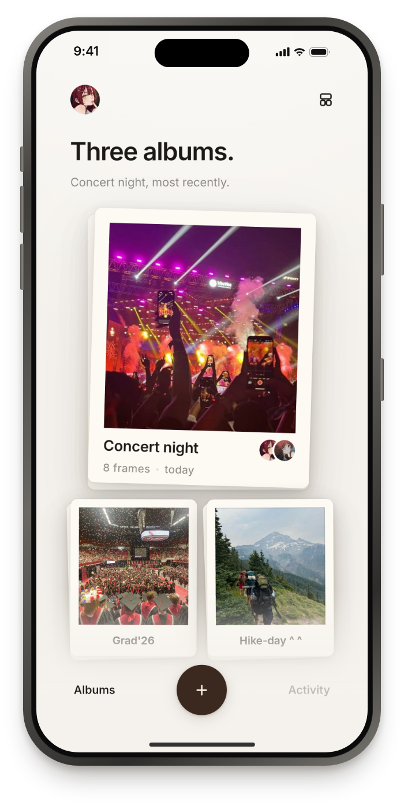
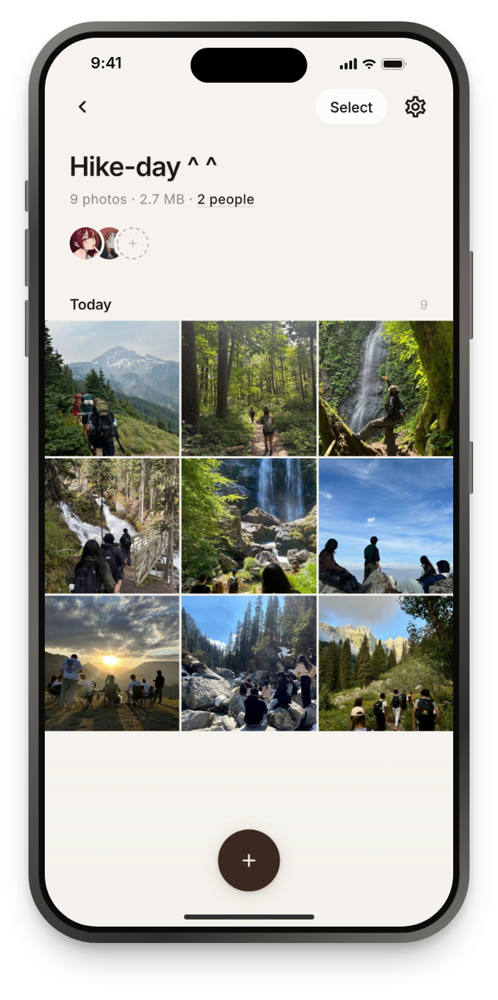
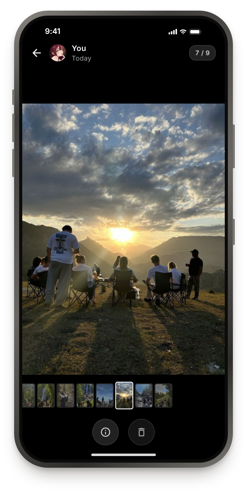
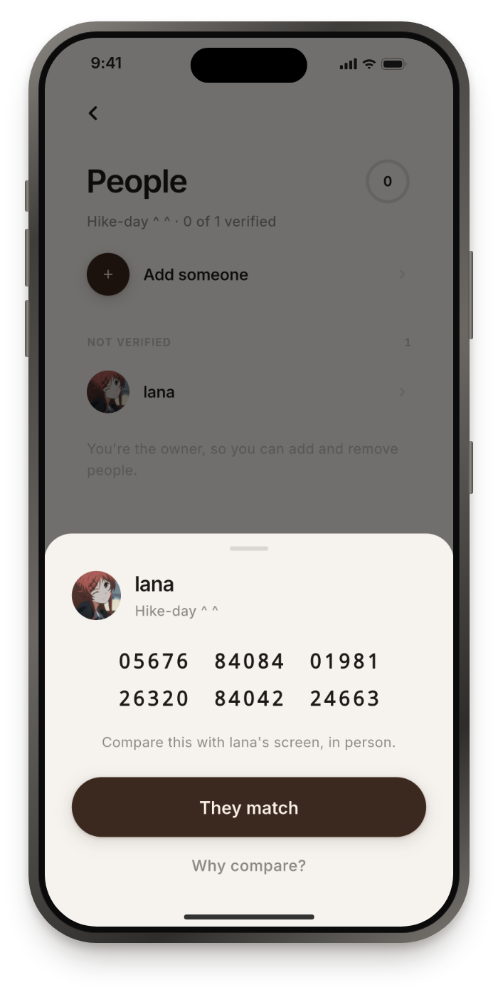

# Miuchio

A shared photo album for small groups, end-to-end encrypted. Photos are encrypted on your phone before they are uploaded, and only the people in the album hold the keys. The server stores the encrypted copies and enforces the album's rules, but it is never given the keys to open them.

[Website](https://www.miuchio.com) · [How it works](https://www.miuchio.com/how-it-works) · [Protocol](https://www.miuchio.com/protocol/overview) · [What Miuchio does not protect](https://www.miuchio.com/protocol/limits)

<p align="center">
  
  
  
  
</p>

## What it does

Miuchio is for a family, a group of friends or the people from one trip. Everyone in an album can add photos.

- Photos, album titles, names and profile photos are encrypted on the phone.
- Location and camera details are removed before a photo is encrypted. If that cannot be done, the photo is not uploaded.
- The server does not store your email address, only a keyed hash of it. People add you with a random Miuchio ID, never by email, phone number or contacts.
- Removing someone moves the album to a new key that only the remaining members receive.
- You can compare a safety number with someone to check that you have the right keys.

## Status

Miuchio is in testing and is not in the App Store or Play Store yet. The Android beta can be downloaded from [Get Miuchio](https://www.miuchio.com/get-miuchio). Expect some bugs while you try it.

- An album holds up to 10 people and has one owner, who can hand it to another member.
- There is no backup and no second device yet. Removing the app or losing your phone means losing access to your albums.
- The protocol and the code have not had an independent security review. Do not rely on Miuchio where a failure would put someone at risk.

Every known limit is listed on [What Miuchio does not protect](https://www.miuchio.com/protocol/limits).

## Roadmap

- **Beta v1**, in testing: encrypted albums, invites, removal, handing an album over, safety numbers, reporting and blocking, offline browsing and account deletion
- **Beta v2**, planned: videos, comments and heart reactions
- **Beta v3**, planned: backup, so you can get your albums back after removing the app

## How the encryption works

Most of the cryptography is standard: Ed25519, X25519, HKDF-SHA256 and AES-256-GCM, with libsodium on the phone. Keys are organised in three layers, so that changing who is in an album never means encrypting a photo again:

```
Identity keys     each phone's own keys; private halves never leave it
     │            a handshake based on Signal's X3DH delivers...
     ▼
Album key         one random key per epoch; a new epoch starts when someone leaves
     │            which encrypts...
     ▼
Photo keys        a random key for each photo and another for its thumbnail
```

The parts I designed myself, such as epochs, signed key changes, the upload freeze during a removal and how the database reduces identifying membership metadata, are explained with their reasons in the [Protocol overview](https://www.miuchio.com/protocol/overview).

## Repository layout

| Path | What is in it |
| --- | --- |
| `server/` | Go API server, with Postgres, Redis and S3 compatible storage |
| `server/internal/e2ee/` | The server's protocol checks: prekeys, epochs and invites |
| `server/migrations/` | Database schema, applied when the server starts |
| `server/cmd/` | The server, the moderation tool and the test vector generators |
| `client/` | Flutter app for Android and iPhone, described in [client/README.md](client/README.md) |
| `test_vectors/` | Known answer tests that the Go server and the Dart app must both match byte for byte |
| `brand/` | App icons and the screenshots above |
| `tools/` | Development scripts for performance traces and onboarding animations |

## Running it yourself

You need Docker with Docker Compose, [Flutter](https://docs.flutter.dev/get-started/install) 3.44 or newer, and a phone or emulator.

```bash
cp .env.example .env              # set S3_PUBLIC_ENDPOINT to your computer's LAN IP
docker compose up --build

cd client
flutter run --dart-define=API_BASE_URL=http://<your LAN IP>:8080/api/v1
```

Sign in with any email address. In a local setup the server prints the sign in code in its log, which you can follow with `docker compose logs -f server`.

[docs/development.md](docs/development.md) covers the details: what to install for each platform, every configuration variable, store builds and how to run the tests.

## Contributing

Bug reports, fixes and ideas are welcome. Small fixes can go straight to a pull request. For anything bigger, and for any change to the protocol or cryptography, open an issue first so we can agree on the approach. [CONTRIBUTING.md](CONTRIBUTING.md) has the details.

If you find a security or protocol bug, please tell me privately first, as described in [SECURITY.md](SECURITY.md).

## Get in touch

- Signal: `freytastic.47`, where I reply fastest
- Discord: `freytastic`
- Email: [uExistentialist@proton.me](mailto:uExistentialist@proton.me), which can take a while

## License

Miuchio is licensed under the [GNU Affero General Public License v3.0](LICENSE). If you run a modified version of the server for other people, you have to make your changes available to them under the same license.

Miuchio is designed and built by [Freytastic](https://www.freytastic.dev/).
